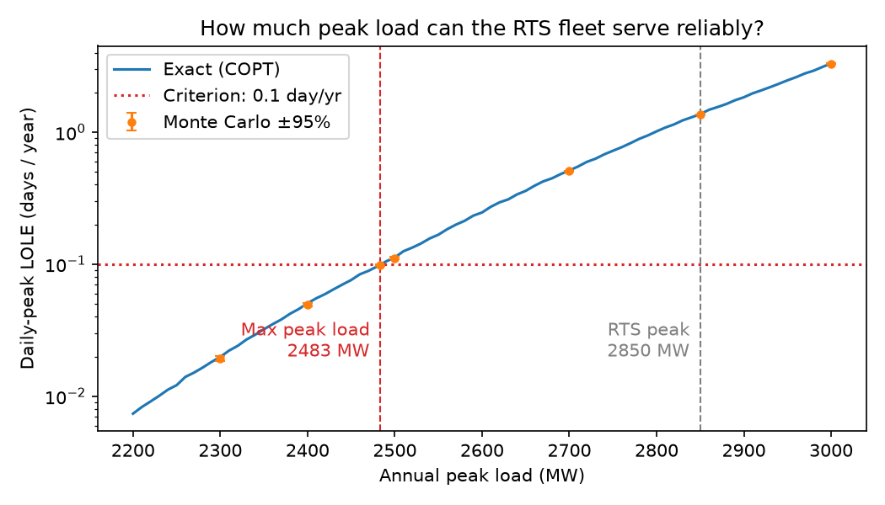
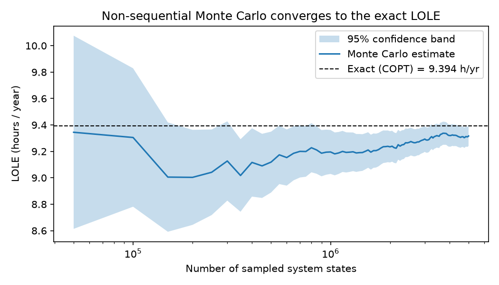
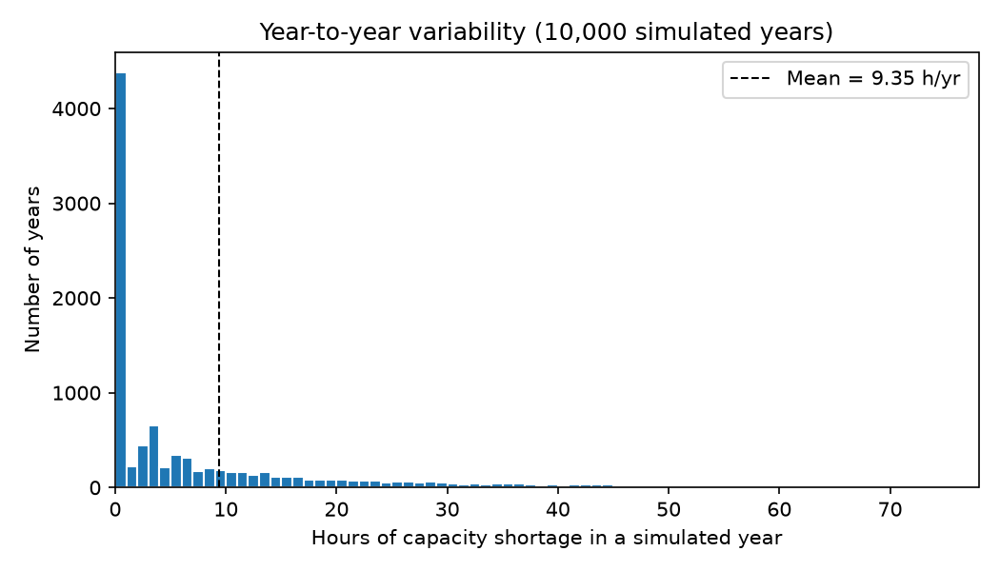

# Power System Reliability: Monte Carlo Adequacy Assessment of the IEEE RTS-79

How often will a power system fail to have enough generation to meet demand, and how
much demand can it reliably serve? This project answers both questions for the
**IEEE Reliability Test System (RTS-79)**, the standard benchmark in power system
reliability. It uses Monte Carlo simulation and checks every result against an exact
analytical solution.

**Main result:** the RTS generating fleet (32 units, 3405 MW) serves its 2850 MW peak
with a loss-of-load expectation of **1.37 days/year**, about 14 times the common
*"one day in ten years"* planning standard (0.1 day/year). To meet that standard,
its peak load must not exceed **2483 MW**, 12.9% below the RTS peak.



## The problem

Generating units fail at random and take time to repair. Whether the lights stay on
in a given hour depends on which units are available and how high demand is.
Standard adequacy indices:

| Index | Meaning |
|---|---|
| **LOLE**, loss of load expectation | Expected hours (or days) per year in which available generation is less than load |
| **EENS**, expected energy not served | Expected MWh per year of demand that cannot be supplied |
| **LOLF**, loss of load frequency | Expected number of separate shortage events per year |

The RTS-79 data: 32 generating units (12 to 400 MW) with forced outage rates, mean
time to failure and mean time to repair, plus a chronological hourly load profile
for an 8736-hour year with a 2850 MW peak.

## Methods

1. **Exact reference: capacity outage probability table (COPT).** The probability
   distribution of available capacity is built by convolving the 32 two-state units,
   then evaluated against every hour of the load curve. This reproduces the published
   RTS values (LOLE 9.394 h/yr, EENS 1176 MWh/yr) to all reported digits, which
   confirms that the input data is entered correctly.
2. **Non-sequential Monte Carlo (state sampling).** Random snapshots of unit up/down
   states are drawn. Each snapshot is scored against *the whole* load curve at once
   (a sorted load curve with prefix sums makes this O(log n)), rather than a single
   random hour. This lowers the variance considerably at no extra cost.
3. **Sequential (chronological) Monte Carlo.** Each unit's failure and repair history
   is simulated hour by hour for 10,000 years using exponential up and down times.
   It is slower, but it is the only one of the three that gives shortage
   **frequency and duration** and the **year-to-year spread** of the indices.

## Results

Base case, 2850 MW peak (± values are 95% confidence intervals):

| Method | LOLE (h/yr) | EENS (MWh/yr) |
|---|---|---|
| Exact (COPT) | 9.394 | 1176.3 |
| Non-sequential MC, 5 million states | 9.317 ± 0.075 | 1163.6 ± 14.3 |
| Sequential MC, 10,000 years | 9.354 ± 0.317 | 1175.3 ± 57.1 |

The sequential simulation also shows that the system averages **1.92 shortage events
per year**, each lasting **4.9 hours** on average. Shortages are very uneven from year
to year: 44% of simulated years have none, while a few have more than 40 hours. An
average like 9.4 h/yr therefore hides a large tail risk.

| Convergence of the Monte Carlo estimate | Spread across simulated years |
|---|---|
|  |  |

**Peak load carrying capability.** Bisection on the exact daily-peak LOLE finds the
largest peak load that meets 0.1 day/year: **2483.3 MW**. An independent Monte Carlo
run at that load gives 0.098 ± 0.002 days/year, which agrees.

## Run it yourself

```bash
python -m venv .venv
.venv\Scripts\activate          # Windows  (macOS/Linux: source .venv/bin/activate)
pip install -e ".[dev]"

python run_study.py             # full study (~2 min): prints results, writes figures/ and results.json
python run_study.py --quick     # ~15 s version
pytest                          # 6 tests, including checks against the published RTS values
```

## Project structure

```
src/reliability/
    rts.py          IEEE RTS-79 generator data and 8736-hour load model
    analytical.py   exact COPT-based LOLE / EENS
    montecarlo.py   non-sequential and sequential Monte Carlo
run_study.py        runs the study, makes the figures
tests/              hand-checked cases + published benchmark values
```

## Assumptions and possible extensions

- Generation only (hierarchical level I): transmission is assumed perfectly reliable,
  and there is no scheduled maintenance, derated states or load forecast uncertainty.
- Possible next steps: add wind/solar to compute their **capacity credit (ELCC)**, add
  planned maintenance schedules, or apply variance reduction (importance sampling) to
  very reliable systems.

## Reference

IEEE RTS Task Force of the APM Subcommittee, "IEEE Reliability Test System,"
*IEEE Transactions on Power Apparatus and Systems*, vol. PAS-98, no. 6,
pp. 2047-2054, 1979.
